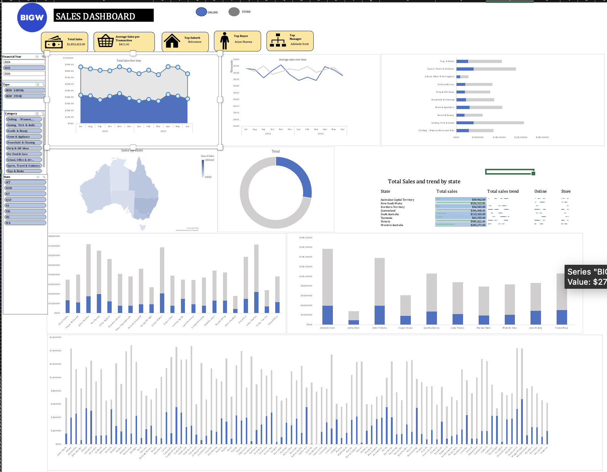

# Big W Sales Dashboard

An interactive one-screen Excel dashboard tracking **$1.85M in Big W sales across 4,505 transactions**, comparing the online (E-Retail) and in-store channels across Australia from FY2024 to FY2026.

## Download

[Download the Excel workbook](https://github.com/kurian11/BigW-Dashboard/raw/main/BigW_Sales_Dashboard.xlsx). Open it in Excel and use the slicers on the left to filter the dashboard.

## What the dashboard shows

| Area | Details |
|---|---|
| **KPI cards** | Total sales ($1,853,423), average sales per transaction ($411.41), top suburb, top buyer, top manager |
| **Trends** | Total and average sales by month across FY2024–FY2026, split by online vs store |
| **Geography** | Filled map of sales by state; state summary table with total sales, data bars and sparkline trends per channel |
| **Channel mix** | Donut chart of online vs store share |
| **Breakdowns** | Sales by category, plus stacked online/store comparisons by manager, buyer and suburb |

## Interactivity

Four connected slicers filter every KPI and chart at once:

- **Financial Year:** 2024, 2025, 2026
- **Type:** Big W E-Retail, Big W Store
- **Category:** 10 product categories, from Clothing to Toys & Books
- **State:** all eight states and territories

## How it's built

- Raw transaction data cleaned into a single master table
- One pivot table per view, each on its own worksheet (sales by category, suburb, type, state, buyer and manager), plus a sparkline sheet
- Pivot charts, a filled map chart and sparklines assembled on a single **Dashboard** sheet
- Slicers connected to all pivots so the whole dashboard filters together

## Questions it answers

- Which states grew online sales this year?
- Which category drives in-store revenue in a given state?
- Which managers and buyers generate the most sales, and through which channel?

## Tools

Excel · Pivot Tables · Pivot Charts · Slicers · Map Charts · Sparklines · Conditional Formatting

## Author

**Kurian Thomas**, Data Science graduate, Melbourne
[Data Science Portfolio](https://www.datascienceportfol.io/kurianthomas1001) · [kurianthomas1001@gmail.com](mailto:kurianthomas1001@gmail.com)
